

# NikkChat

**A messenger that runs in the browser and installs to the home screen.** 
End-to-end encrypted chats, groups, photos and voice notes, plus voice and video calls. Live at [nikkchat.com](https://nikkchat.com).

---

> **Note on source code.** NikkChat is a closed-source product. This repository is a public
> case study describing what was built and how. The full source is private. If you're a recruiter
> or a hiring engineer who would like a code walkthrough, reach out — I'm happy to share a
> read-only invite for review.

---

## What it is

NikkChat is a messenger I built and run at [**nikkchat.com**](https://nikkchat.com). It is a
Progressive Web App: open the site, add it to your home screen, and it behaves like an
installed app on iPhone, Android and desktop, with no app store in between.

People find each other by name, @username, an invite link or its QR code, never by phone
number. Chats are between two people or in a group of up to 50: text, photos, videos and
voice notes, with replies, reactions, edits and read ticks. Voice and video calls connect
device to device over WebRTC. There is no feed, no follower count and no ads.

Messages and media are **end-to-end encrypted**: sealed in the sender's browser with keys
only the people in the chat hold, so the servers store ciphertext. What that covers and what
it doesn't (calls, collections, who talks to whom) is written down in
[`docs/SECURITY.md`](docs/SECURITY.md) and on
[nikkchat.com/security](https://nikkchat.com/security).

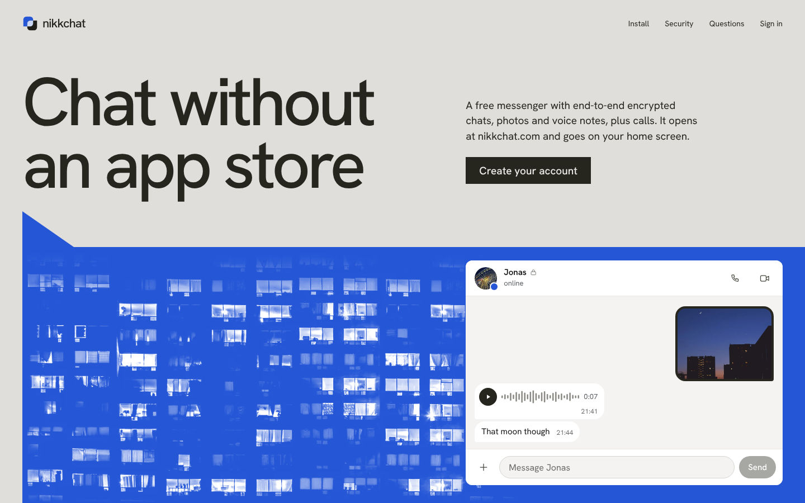

## Screenshots

Captured from the app running on sample conversations. The names and messages are made up.

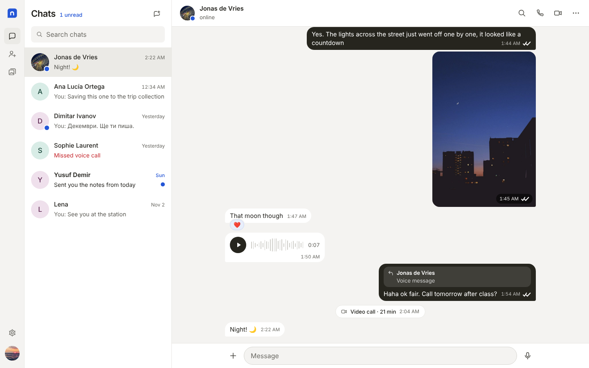

<table>
  <tr>
    <td align="center" width="33%">
      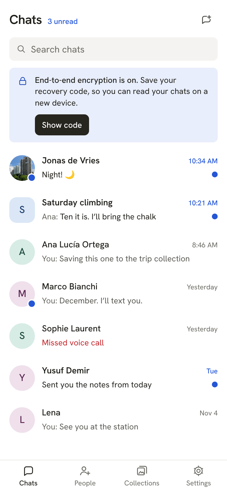 
      <b>Chat list: a group, unread and online marks, the recovery-code reminder</b>
    </td>
    <td align="center" width="33%">
      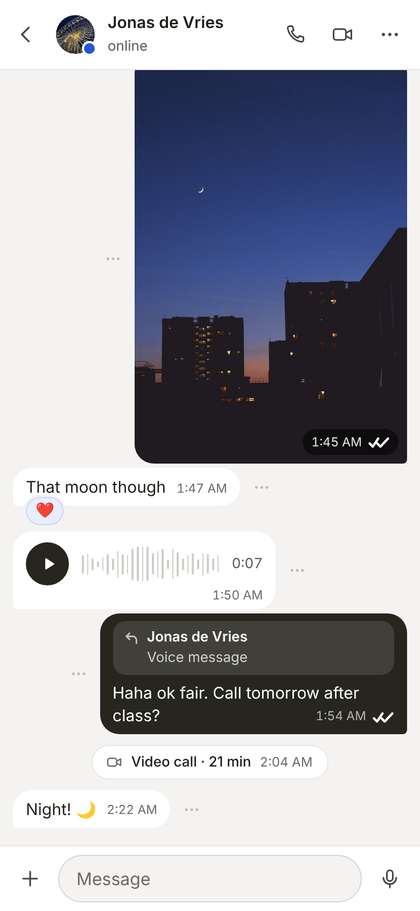 
      <b>A chat: photo, reaction, voice note, reply, a logged call</b>
    </td>
    <td align="center" width="33%">
      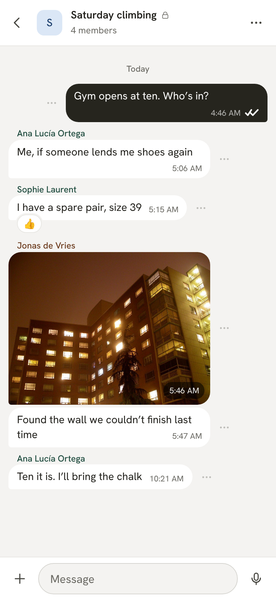 
      <b>A group, with each sender named</b>
    </td>
  </tr>
  <tr>
    <td align="center" width="33%">
      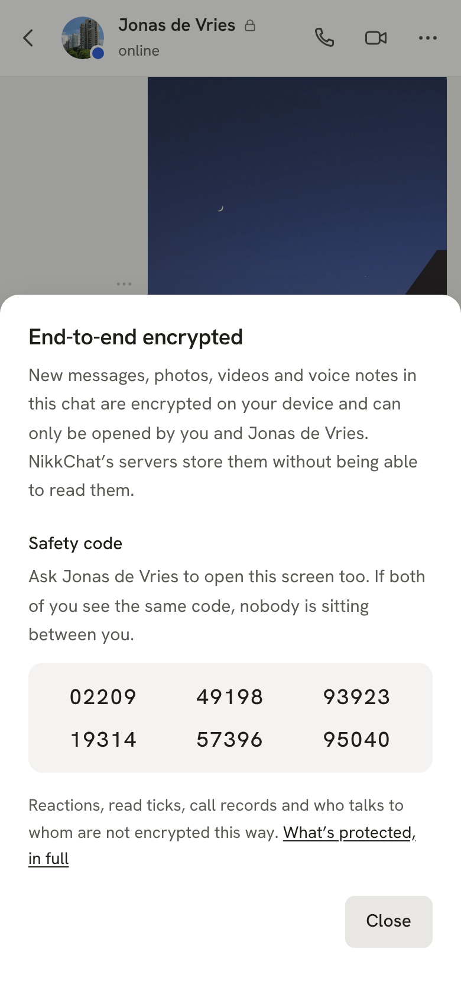 
      <b>The safety code two people compare</b>
    </td>
    <td align="center" width="33%">
      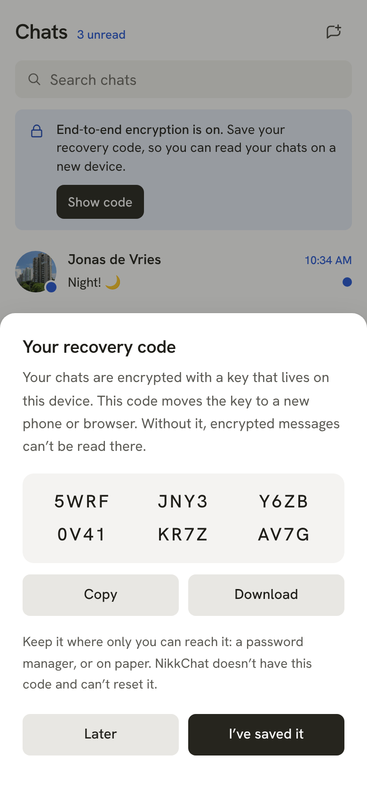 
      <b>The recovery code that moves the key to a new device</b>
    </td>
    <td align="center" width="33%">
      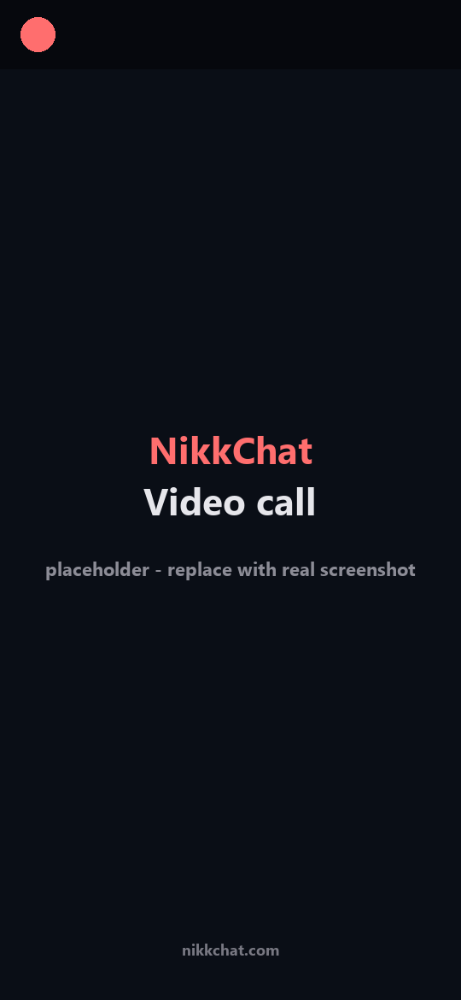 
      <b>Incoming video call</b>
    </td>
  </tr>
  <tr>
    <td align="center" width="33%">
      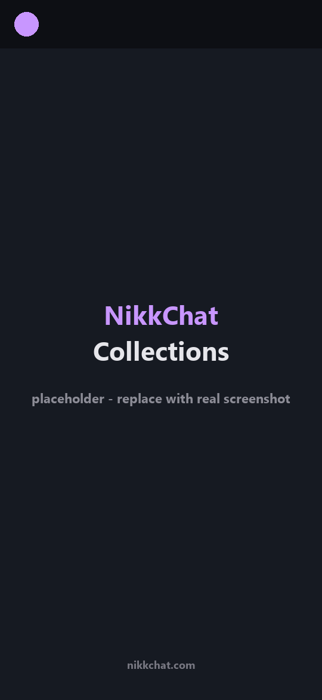 
      <b>Collections of saved photos, public or private</b>
    </td>
    <td align="center" width="33%">
      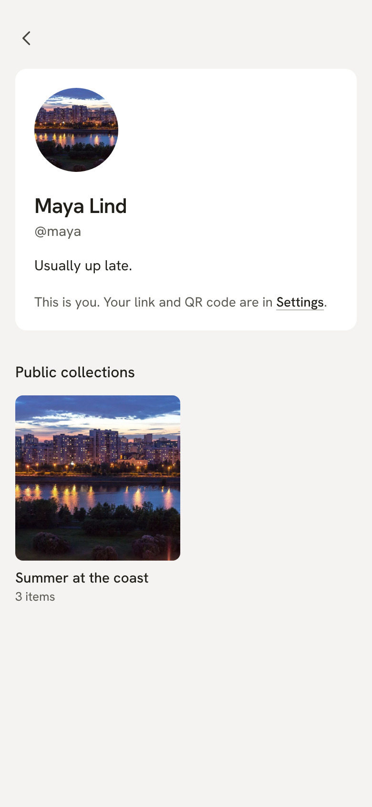 
      <b>A profile with its @username and public collections</b>
    </td>
    <td align="center" width="33%">
      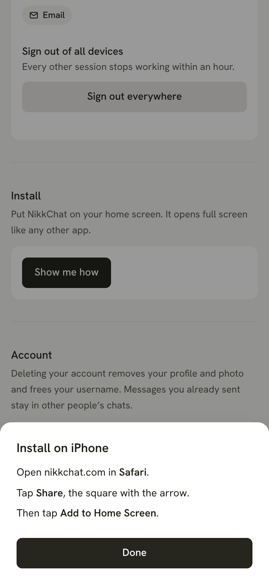 
      <b>The install guide for iPhone</b>
    </td>
  </tr>
</table>

The photos inside the captures are free-licensed images; see
[`screenshots/README.md`](screenshots/README.md) for who took them. The codes in the two
encryption captures belong to a throwaway sample account.

## What it does

### Chats
- Chats between two people, and groups of up to 50 with admins who add and remove people.
- Text, photos, videos and voice notes, with replies, reactions, edits, and delivered and
  read ticks.
- Search inside a conversation, done on the device, so it works on encrypted messages too.
- Typing and online status over Realtime Database. Online status can be switched off, and
  while it is off nothing is published.

### Encryption
- Messages, photos, videos and voice notes are sealed in the browser before they leave it,
  in chats and in groups. The servers store ciphertext, and wrapped keys they can't open.
- Built on the browser's WebCrypto with no crypto library: ECDH P-256 identity keys,
  HKDF-SHA-256, AES-256-GCM. A group has its own key, replaced when someone leaves.
- A recovery code, shown once, carries the keys to a new device. NikkChat never has it.
- A safety code for two people to compare, and a warning when a contact's key changes.
- Once a chat is encrypted, the app refuses to send into it in the clear, and a message that
  arrives without encryption is marked as such instead of looking like the rest.

### Calls
- Voice and video between two people over WebRTC, device to device. Firebase only carries
  the call setup.
- An incoming-call screen with accept and decline. Unanswered calls time out, and a blocked
  account can't make your phone ring.

### People
- @usernames, search by name or username, an invite link (`nikkchat.com/u/<name>`) and its
  QR code.
- A phone number verifies the account. It is never searchable and never shown on a profile.
- Blocking, with a block list only its owner can read.

### Collections
- Save photos and videos from any chat into a collection.
- Keep a collection private or make it public. Public ones show on your profile.

### Accounts
- Email and password, with the phone number verified by SMS at sign-up; Google and Microsoft
  sign-in.
- Password reset by email link or by SMS code.
- New passwords are checked against known leaks through Have I Been Pwned, without sending
  the password.
- Changing the email or password, or deleting the account, asks for the password again.
- Sign out of every device at once.

### Media
- Photos are redrawn as WebP in the browser before they upload, which leaves the location
  and camera details behind. A setting adds a second metadata pass.
- Avatar crop, a lightbox and a media viewer with swipe, save to device.

### Install
- Installs from the browser on iPhone, Android and desktop. No app store.
- A service worker caches the app shell, and new versions install themselves.
- An install prompt with the steps for each platform.

## Built, switched on separately

Two features are finished in code but each needs a key from an outside service, so they go
live on their own schedule. Until then the site says they aren't switched on.

- **Notifications while the app is closed.** Web push through Firebase Cloud Messaging. A
  Cloud Function sends one when a message or a call arrives, carrying a name and the kind of
  thing, never the text. The service worker shows it and opens the right chat.
- **A relay for calls.** A Cloud Function hands each device short-lived credentials for
  Cloudflare's TURN service, so a call connects on networks that block direct connections.
  The relay forwards the stream WebRTC has already encrypted.

Both are tested up to the boundary with the outside service. The delivery itself can only be
checked once the keys exist.

## What it doesn't do yet

- **Forward secrecy.** Encryption keys are long-lived, so a key stolen later opens ciphertext
  captured earlier.
- **Membership the server can't change.** Who is in a group is kept by the server, and members'
  apps hand the group's key to everyone on that list. The list is visible; a change to it
  isn't yet announced in the conversation.
- **The same guarantee for calls and collections.** Calls are encrypted by WebRTC but aren't
  tied to the identity keys, and a photo saved to a collection leaves the chat's encryption.
- **Group calls**, and typing indicators and a safety code in groups.
- **Erasing stored files** when a message or a conversation is deleted.
- **Two-factor sign-in.**

## Architecture

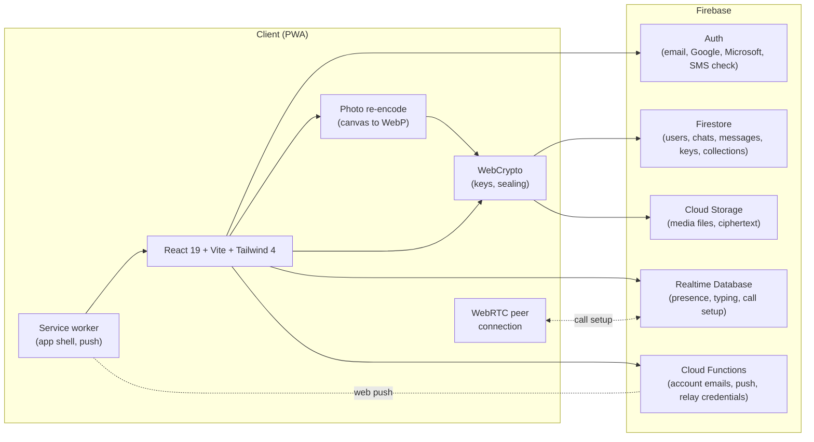

**Why this stack**

- **Firebase** handles auth, persistence and call setup without me running servers.
  Firestore's realtime listeners give me a reactive chat list; Realtime Database's lower
  latency and `onDisconnect` suit typing and presence; Storage holds the media files.
- **Security rules are the backend.** With no server of my own in front of the data, the
  rules decide who can read and write what, so they are written to be strict and they are
  tested.
- **WebCrypto, not a crypto library.** The primitives are the browser's, so the code I have
  to get right is the key handling: who gets which key, when it changes, and what the app
  refuses to do without one.
- **Long-lived identity keys and a recovery code, not a ratchet.** A second device and a lost
  phone stay simple to explain and to recover from. The price is no forward secrecy.
- **WebRTC with Realtime Database for call setup** keeps calls device to device. Firebase
  only exchanges the offer, the answer and the connection candidates, never the call media.
- **A PWA** beats native app stores for a solo developer: one codebase, instant updates, no
  review cycles, installable on every platform.

## How it's checked

- **208 rule checks** against the Firebase emulators, as four accounts: two who share a chat,
  one who doesn't, and one who is only ever in groups. Each line is something the rules must
  allow or refuse.
- **A run of the real screens as three people in separate browsers**, 40 steps: sign in, get
  keys, save a recovery code, chat, edit, react, send a photo and a voice note, save to a
  collection, unlock on a new browser with the code, call, block, make a group, remove
  someone, leave, then delete the group, the chat and the account. A single "permission
  denied" in any browser fails the run.
- **The same run reads what the server stored.** It fails if a message's text, a preview or a
  file name is there in the clear, or if someone removed from a group is handed the next key.
- **And it writes to the server directly**, the way someone with access to it could. Text
  planted beside an encrypted message must not be shown, and a message planted without
  encryption must come out marked.
- **20 checks on the cryptography and on what a thread shows**: two people derive the same
  key and a third can't; a message moved to another chat or sender, a tampered ciphertext, a
  wrong recovery code and another account's backup are all refused; an opened message can't
  overwrite who it is from.
- **6 checks on the push handling**, driven through the service worker of a production build.
- The site and the app are looked at in a real browser at phone, tablet and desktop widths,
  with worst-case data: long names, empty lists, missing photos, thousands of items.

## Tech stack

| Layer | Tech |
|---|---|
| **UI** | React 19, Vite 8, Tailwind CSS 4 |
| **Routing** | React Router 7 |
| **State** | React Context + custom hooks |
| **Auth** | Firebase Auth (email and password, Google, Microsoft, SMS verification) |
| **Database** | Firestore + Firebase Realtime Database |
| **Storage** | Firebase Cloud Storage |
| **Encryption** | WebCrypto: ECDH P-256, HKDF-SHA-256, AES-256-GCM, PBKDF2. Keys kept in IndexedDB |
| **Calls** | WebRTC, device to device. Cloudflare TURN relay built, switched on separately |
| **Notifications** | Firebase Cloud Messaging web push. Built, switched on separately |
| **Media** | Canvas re-encode to WebP, exifr (metadata), react-easy-crop (avatar) |
| **PWA** | vite-plugin-pwa (Workbox service worker) |
| **Backend functions** | Firebase Cloud Functions: account emails through Resend, push, relay credentials, account clean-up |
| **Hosting** | Firebase Hosting + custom domain ([nikkchat.com](https://nikkchat.com)) |
| **Type** | Hanken Grotesk, self-hosted |
| **Tooling** | ESLint 9, patch-package, Firebase emulators and Playwright for the tests |

## Documentation

This repository contains design notes about the project. The source itself is private.

- [`docs/ARCHITECTURE.md`](docs/ARCHITECTURE.md): system overview, data model, how a message, a photo and a call travel
- [`docs/SECURITY.md`](docs/SECURITY.md): what NikkChat protects, how the encryption works, who it doesn't protect against, and the access rules
- [`docs/ROADMAP.md`](docs/ROADMAP.md): what's shipped and what's next

## Try it

The latest version is always live at **[nikkchat.com](https://nikkchat.com)**. Sign in or
create an account to use it. On a phone, "Add to Home Screen" turns it into an app.

## Hire / collaborate

I'm Kevin Rusev, a programming student in Bulgaria. NikkChat is one of the projects I'm
building toward a junior gameplay / engineering role.

If you'd like a code walkthrough, an architecture deep-dive call, or you're hiring junior
engineers — reach me at **[kevinrusev1@gmail.com](mailto:kevinrusev1@gmail.com)**.

---

NikkChat is a closed-source product. This repository documents the work; it does not contain the source. © 2025–2026 Kevin Rusev. All rights reserved.
