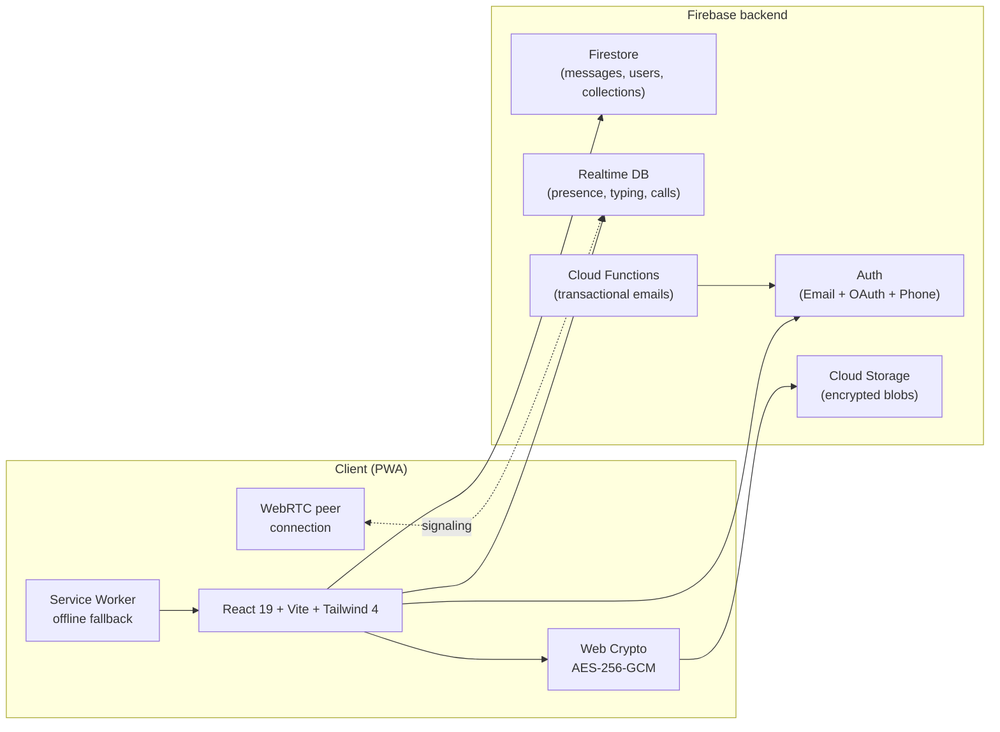

# NikkChat

**Encrypted messaging, voice & video calls, and media sharing.**
**Installable on Android, iPhone, and desktop.**

---

> **Note on source code.** NikkChat is a closed-source product. This repository is a public
> case study describing what was built and how. The full source is private. If you're a recruiter
> or a hiring engineer who would like a code walkthrough, reach out — I'm happy to share a
> read-only invite for review.

---

## What it is

NikkChat is a privacy-first messenger I built and ship at [**nikkchat.com**](https://nikkchat.com).
It's a Progressive Web App that installs on any device, runs without an app store, and treats
media as **end-to-end encrypted by default** — every image, video, and voice message is
encrypted client-side before it ever touches a server.

It also handles **peer-to-peer voice and video calls** over WebRTC, supports **passwordless
sign-in via Google / Apple / Microsoft / phone OTP**, and keeps the social graph deliberately
minimal — there's no public feed, no follower count, no algorithm. Just people you know.

## Screenshots

> Real screenshots from production (`nikkchat.com`).

<table>
  <tr>
    <td align="center" width="33%">
       
      <b>Chat list with presence indicators</b>
    </td>
    <td align="center" width="33%">
       
      <b>Encrypted media inside a chat</b>
    </td>
    <td align="center" width="33%">
       
      <b>WebRTC peer-to-peer video call</b>
    </td>
  </tr>
  <tr>
    <td align="center" width="33%">
       
      <b>Public / private media collections</b>
    </td>
    <td align="center" width="33%">
       
      <b>Profile with @tag and avatar crop</b>
    </td>
    <td align="center" width="33%">
       
      <b>Installable PWA on iOS / Android / desktop</b>
    </td>
  </tr>
</table>

## Feature highlights

### Privacy & security
- **End-to-end encrypted media** — every image, video, and voice message is encrypted in the
  browser with a unique AES-256-GCM key before upload. The server only ever stores ciphertext.
- **Per-blob ephemeral keys** — a fresh 256-bit key + 96-bit IV is generated for each upload,
  exported as base64, and delivered alongside the message envelope. The Web Crypto API does the
  heavy lifting; no third-party crypto libraries.
- **Optional EXIF stripping** — toggle metadata removal before upload so location/camera/timestamps
  don't leak to the recipient.
- **Reauthentication for sensitive actions** — destructive actions (delete account, change email,
  rotate password) require fresh credentials.
- **No public feed, no follower system, no algorithm** — minimal social graph by design.

### Real-time
- **Real-time messaging** over Firestore with Realtime Database for presence and typing indicators.
- **Read receipts** and **last-seen** with privacy-respecting opt-outs.
- **WebRTC peer-to-peer voice and video calls** with ringer notifications, accept/decline UI, and
  graceful failure handling for offline peers.

### Auth
- Email/password with verification email and **password strength scoring**.
- **Google**, **Apple**, and **Microsoft** OAuth.
- **Phone OTP** with anti-abuse SMS cooldown.
- Forgot-password flow with custom auth-action handling.

### Media & UX
- **Image / video / voice message** upload with progress, retries, and thumbnail generation.
- **Avatar cropping** in-browser with a circular crop UI.
- **Lightbox** and full **media viewer** with swipe navigation.
- **Save to device** for any received media.
- **Decrypted media cache** to avoid re-decrypting on scroll.

### Collections
- Organize media into **public** or **private** collections.
- Share collections via **link or QR code**.
- Add to a collection from any chat with one tap.

### Distribution
- **PWA-first** — no app store. Installs on Android, iOS, and desktop directly from the browser.
- **Service worker** with offline fallback for the chat list.
- Custom **install prompt** with platform-aware copy.

## Architecture

**Why this stack**

- **Firebase** handles auth, persistence, and signalling without me running infra. Firestore's
  realtime listeners give me reactive UI for free; RTDB's lower latency is perfect for typing
  and presence; Storage is the dumb-bytes layer for encrypted blobs.
- **WebRTC over RTDB signalling** keeps the call setup peer-to-peer — the Firebase stack only
  exchanges SDP offers/answers, never the call media.
- **PWA** beats native app stores for solo dev velocity: one codebase, instant updates, no review
  cycles, installable on every platform.

## Tech stack

| Layer | Tech |
|---|---|
| **UI** | React 19, Vite 8, Tailwind CSS 4 |
| **Routing** | React Router 7 |
| **State** | React Context + custom hooks |
| **Auth** | Firebase Auth (Email, Google, Apple, Microsoft, Phone) |
| **Database** | Firestore + Firebase Realtime Database |
| **Storage** | Firebase Cloud Storage |
| **Crypto** | Web Crypto API (AES-256-GCM) |
| **Calls** | WebRTC peer-to-peer |
| **Media** | Sharp (server-side thumbnails), exifr (metadata strip) |
| **PWA** | vite-plugin-pwa, custom service worker |
| **Backend functions** | Firebase Cloud Functions (Node 20) |
| **Hosting** | Firebase Hosting + custom domain ([nikkchat.com](https://nikkchat.com)) |
| **Tooling** | ESLint 9, patch-package, Tailwind CLI |

## Documentation

This repository contains design notes about the project. The source itself is private.

- [`docs/ARCHITECTURE.md`](docs/ARCHITECTURE.md) — system overview, data flow, why each stack choice
- [`docs/SECURITY.md`](docs/SECURITY.md) — encryption model, threat model, what NikkChat does and doesn't protect against
- [`docs/ROADMAP.md`](docs/ROADMAP.md) — shipped features and what's next

## Try it

The latest version is always live at **[nikkchat.com](https://nikkchat.com)**. Sign in or
create an account to use it. On mobile, "Add to Home Screen" turns it into a real app.

## Hire / collaborate

I'm Kevin Rusev, a programming student in Bulgaria. NikkChat is one of the projects I'm
building toward a junior gameplay / engineering role.

If you'd like a code walkthrough, an architecture deep-dive call, or you're hiring junior
engineers — reach me at **[kevinrusev1@gmail.com](mailto:kevinrusev1@gmail.com)**.

---

NikkChat is a closed-source product. This repository documents the work; it does not contain the source. © 2025–2026 Kevin Rusev. All rights reserved.
