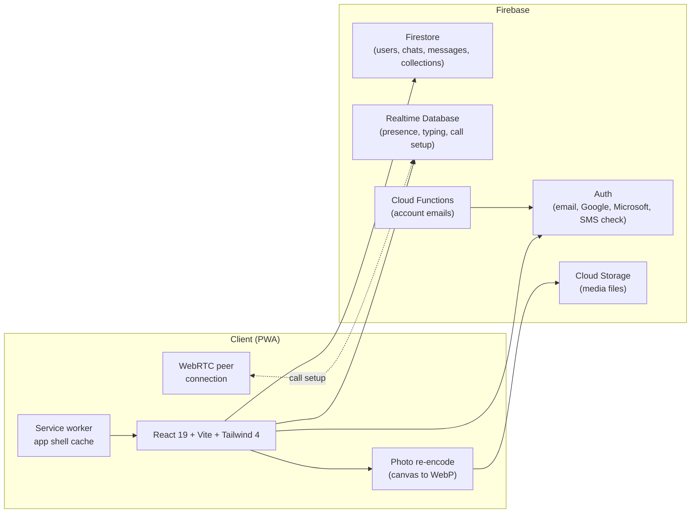

# NikkChat

**A messenger that runs in the browser and installs to the home screen.** 
One-to-one chats, photos, voice notes, and voice and video calls. Live at [nikkchat.com](https://nikkchat.com).

---

> **Note on source code.** NikkChat is a closed-source product. This repository is a public
> case study describing what was built and how. The full source is private. If you're a recruiter
> or a hiring engineer who would like a code walkthrough, reach out — I'm happy to share a
> read-only invite for review.

---

## What it is

NikkChat is a messenger I built and run at [**nikkchat.com**](https://nikkchat.com). It is a
Progressive Web App: open the site, add it to your home screen, and it behaves like an
installed app on iPhone, Android and desktop, with no app store in between.

People find each other by name, @username, an invite link or its QR code, never by phone
number. Chats are between two people: text, photos, videos and voice notes, with replies,
reactions, edits and read ticks. Voice and video calls connect device to device over WebRTC.
There is no feed, no follower count and no ads.

It is **not end-to-end encrypted**, and nothing here says it is. What is protected today, and
what isn't yet, is written down in [`docs/SECURITY.md`](docs/SECURITY.md) and on
[nikkchat.com/security](https://nikkchat.com/security).

## Screenshots

Captured from the app running on sample conversations. The names and messages are made up.

<table>
  <tr>
    <td align="center" width="33%">
       
      <b>Chat list, with unread and online marks</b>
    </td>
    <td align="center" width="33%">
       
      <b>A chat: photo, reaction, voice note, reply, a logged call</b>
    </td>
    <td align="center" width="33%">
       
      <b>Incoming video call</b>
    </td>
  </tr>
  <tr>
    <td align="center" width="33%">
       
      <b>Collections of saved photos, public or private</b>
    </td>
    <td align="center" width="33%">
       
      <b>A profile with its @username and public collections</b>
    </td>
    <td align="center" width="33%">
       
      <b>The install guide for iPhone</b>
    </td>
  </tr>
</table>

The photos inside the captures are public-domain images; see
[`screenshots/README.md`](screenshots/README.md) for who took them.

## What it does

### Chats
- One-to-one chats over Firestore: text, photos, videos and voice notes.
- Replies, reactions, edits, delivered and read ticks.
- Typing and online status over Realtime Database. Online status can be switched off, and
  while it is off nothing is published.

### Calls
- Voice and video over WebRTC, device to device. Firebase only carries the call setup; sound
  and picture never pass through a NikkChat server.
- An incoming-call screen with accept and decline. Unanswered calls time out, and a blocked
  account can't make your phone ring.

### People
- @usernames, search by name or username, an invite link (`nikkchat.com/u/<name>`) and its
  QR code.
- A phone number verifies the account. It is never searchable and never shown on a profile.
- Blocking.

### Collections
- Save photos and videos from any chat into a collection.
- Keep a collection private or make it public. Public ones show on your profile.

### Accounts
- Email and password, with the phone number verified by SMS at sign-up; Google and Microsoft
  sign-in.
- Password reset by email link or by SMS code.
- New passwords are checked against known leaks through Have I Been Pwned, without sending
  the password.
- Changing the email or password, or deleting the account, asks for the password again.
- Sign out of every device at once.

### Media
- Photos are redrawn as WebP in the browser before they upload, which leaves the location
  and camera details behind. A setting adds a second metadata pass.
- Avatar crop, a lightbox and a media viewer with swipe, save to device.

### Install
- Installs from the browser on iPhone, Android and desktop. No app store.
- A service worker caches the app shell, and new versions install themselves.
- An install prompt with the steps for each platform.

## What it doesn't do yet

- **End-to-end encryption.** Messages and media are encrypted in transit and at rest, not
  end to end.
- **Notifications while the app is closed.**
- **A relay (TURN) server**, so a call can fail on a network that blocks direct connections.
- **Group chats.**

## Architecture

**Why this stack**

- **Firebase** handles auth, persistence and call setup without me running servers.
  Firestore's realtime listeners give me a reactive chat list; Realtime Database's lower
  latency and `onDisconnect` suit typing and presence; Storage holds the media files.
- **Security rules are the backend.** With no server of my own in front of the data, the
  rules decide who can read and write what, so they are written to be strict and they are
  tested.
- **WebRTC with Realtime Database for call setup** keeps calls device to device. Firebase
  only exchanges the offer, the answer and the connection candidates, never the call media.
- **A PWA** beats native app stores for a solo developer: one codebase, instant updates, no
  review cycles, installable on every platform.

## How it's checked

- **120 rule checks** against the Firebase emulators, as three accounts: two who share a chat
  and one who doesn't. Each line is something the rules must allow or refuse.
- **A two-browser run of the real screens**: sign in, start a chat, send, read, react, send a
  photo, save it to a collection, call, block, delete the chat, delete the account. A single
  "permission denied" in either browser fails the run.
- The site and the app are looked at in a real browser at phone, tablet and desktop widths,
  with worst-case data: long names, empty lists, missing photos, thousands of items.

## Tech stack

| Layer | Tech |
|---|---|
| **UI** | React 19, Vite 8, Tailwind CSS 4 |
| **Routing** | React Router 7 |
| **State** | React Context + custom hooks |
| **Auth** | Firebase Auth (email and password, Google, Microsoft, SMS verification) |
| **Database** | Firestore + Firebase Realtime Database |
| **Storage** | Firebase Cloud Storage |
| **Calls** | WebRTC, device to device |
| **Media** | Canvas re-encode to WebP, exifr (metadata), react-easy-crop (avatar) |
| **PWA** | vite-plugin-pwa (Workbox service worker) |
| **Backend functions** | Firebase Cloud Functions, Resend for account emails |
| **Hosting** | Firebase Hosting + custom domain ([nikkchat.com](https://nikkchat.com)) |
| **Type** | Hanken Grotesk, self-hosted |
| **Tooling** | ESLint 9, patch-package, Firebase emulators for the rule tests |

## Documentation

This repository contains design notes about the project. The source itself is private.

- [`docs/ARCHITECTURE.md`](docs/ARCHITECTURE.md): system overview, data model, how a message, a photo and a call travel
- [`docs/SECURITY.md`](docs/SECURITY.md): what NikkChat protects, who it doesn't protect against, and the access rules
- [`docs/ROADMAP.md`](docs/ROADMAP.md): what's shipped and what's next

## Try it

The latest version is always live at **[nikkchat.com](https://nikkchat.com)**. Sign in or
create an account to use it. On a phone, "Add to Home Screen" turns it into an app.

## Hire / collaborate

I'm Kevin Rusev, a programming student in Bulgaria. NikkChat is one of the projects I'm
building toward a junior gameplay / engineering role.

If you'd like a code walkthrough, an architecture deep-dive call, or you're hiring junior
engineers — reach me at **[kevinrusev1@gmail.com](mailto:kevinrusev1@gmail.com)**.

---

NikkChat is a closed-source product. This repository documents the work; it does not contain the source. © 2025–2026 Kevin Rusev. All rights reserved.
